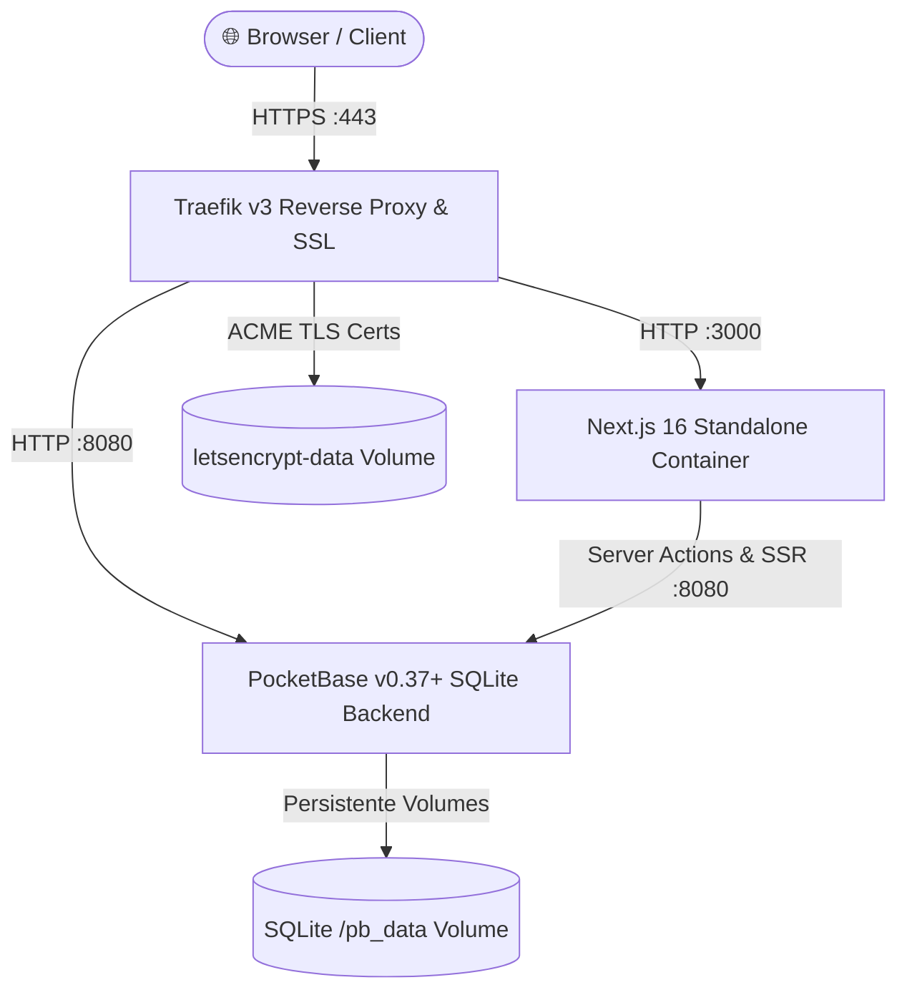

# 📘 Vibeforce Flow OS — Produktions- & Betriebshandbuch (Deployment Guide)

> **Version:** 1.0.0 (Release Candidate)  
> **Status:** Production-Ready  
> **Zielplattform:** Linux VPS / Bare Metal / Cloud (Docker & Docker Compose mit Traefik v3)

---

## 1. Systemübersicht & Architektur

Vibeforce Flow OS ist eine moderne, hochperformante Agentur- und Projektmanagement-Plattform mit integrierter Zeiterfassung, Workload-Planung und rechtskonformer ZUGFeRD 2.2 / Factur-X Rechnungsgenerierung.



### Kernkomponenten
1. **Frontend (Next.js 16 Standalone):** Server-Side Rendering (SSR), React Server Components (RSC), Server Actions und optimierter Multi-Stage Alpine-Container.
2. **Backend (PocketBase v0.37+):** Embedded SQLite im WAL-Modus (Write-Ahead Logging), Real-Time Server-Sent Events (SSE), feingranulares RBAC und JavaScript-Hooks.
3. **Reverse Proxy (Traefik v3):** Automatisches Let's Encrypt TLS/SSL-Zertifikatsmanagement, HTTP-zu-HTTPS-Umleitung, Security Headers und Lastausgleich.

---

## 2. Systemanforderungen & Voraussetzungen

### Empfohlene Hardware-Dimensionierung
| Lastprofil | Aktive Benutzer | CPU | RAM | NVMe SSD |
| :--- | :--- | :--- | :--- | :--- |
| **Small / Agency** | 1 – 25 User | 2 vCPU | 2 GB | 20 GB |
| **Medium / Studio** | 25 – 100 User | 4 vCPU | 4 GB | 50 GB |
| **Large / Enterprise** | 100+ User | 8 vCPU | 8 GB | 100 GB |

### Software-Voraussetzungen
- **Betriebssystem:** Ubuntu 22.04 LTS / 24.04 LTS oder Debian 12
- **Docker Engine:** Version 24.0 oder neuer
- **Docker Compose:** Version 2.20 oder neuer (`docker compose`)
- **DNS:** Öffentlich aufgelöste A/AAAA-Records für deine Domain (z. B. `vibeforce-flow.de` und `pb.vibeforce-flow.de`)

---

## 3. Schnellstart (One-Command Deployment)

### Schritt 1: Repository klonen & Verzeichnis aufrufen
```bash
git clone <repository-url> vibeforce-flow-os
cd vibeforce-flow-os
```

### Schritt 2: Produktions-Umgebungsvariablen konfigurieren
```bash
cp .env.production.example .env
nano .env
```

Passe die folgenden Variablen in der `.env`-Datei an:
```ini
DOMAIN=vibeforce-flow.de
ACME_EMAIL=admin@vibeforce-flow.de
PB_ADMIN_EMAIL=admin@vibeforce-flow.de
PB_ADMIN_PASSWORD=DeinSuperSicheresPasswort123!
```

### Schritt 3: Container starten
```bash
# Produktions-Stack mit Traefik und SSL starten
docker compose -f docker-compose.prod.yml up -d --build
```

### Schritt 4: Status & Healthchecks prüfen
```bash
docker compose -f docker-compose.prod.yml ps
```
Beide Container (`vibeforce-frontend` und `vibeforce-backend`) müssen den Status `healthy` aufweisen.

---

## 4. Lokale Entwicklung & Test-Deployment

Für lokale Tests ohne externe Domain und Traefik steht die Standard-Compose-Datei zur Verfügung:

```bash
# 1. Lokale .env kopieren
cp .env.example .env

# 2. Lokalen Stack starten
docker compose up -d --build

# 3. Zugriff
# Frontend: http://localhost:3000
# Backend Admin-UI: http://localhost:8090/_/
```

---

## 5. Umgebungsvariablen-Referenz

| Variable | Beschreibung | Standard / Beispiel | Erforderlich |
| :--- | :--- | :--- | :--- |
| `DOMAIN` | Hauptdomain der Web-App | `vibeforce-flow.de` | Ja (Prod) |
| `ACME_EMAIL` | E-Mail für Let's Encrypt Benachrichtigungen | `admin@vibeforce-flow.de` | Ja (Prod) |
| `POCKETBASE_URL` | Interne Backend-URL für SSR / Server Actions | `http://backend:8080` | Ja |
| `NEXT_PUBLIC_POCKETBASE_URL` | Öffentliche Backend-URL für den Browser | `https://pb.vibeforce-flow.de` | Ja |
| `PB_ADMIN_EMAIL` | Superuser E-Mail für PocketBase Admin | `admin@vibeforce-flow.de` | Ja |
| `PB_ADMIN_PASSWORD` | Superuser Passwort | `***` | Ja |
| `NEXT_PUBLIC_DEFAULT_HOURLY_RATE` | Standard-Stundensatz in EUR | `150` | Nein |
| `ALLOWED_ORIGINS` | CORS Whitelist | `https://vibeforce-flow.de` | Ja (Prod) |
| `DEEPSEEK_API_KEY` | Optionaler KI-API-Schlüssel | `sk-...` | Nein |

---

## 6. Datenbank-Backup, Snapshot & Restore

PocketBase speichert alle Daten in einer atomaren SQLite-Datenbank unter `/pb/pb_data/data.db`.

### Automatisches Hot-Backup (ohne Downtime)
PocketBase unterstützt Online-Backups über die integrierte Backup-Engine:

```bash
# 1. Hot Backup über Docker Exec erstellen
docker compose exec backend /pb/pocketbase backup create "backup_$(date +%Y%m%d_%H%M%S).zip"

# 2. Backups auflisten
docker compose exec backend /pb/pocketbase backup list
```

### Manuelles Dateisystem-Backup
```bash
# Backup-Verzeichnis erstellen
mkdir -p /opt/backups/vibeforce

# pb_data Volume direkt sichern
docker run --rm \
  -v vibeforce-flow-os_pb-data:/data \
  -v /opt/backups/vibeforce:/backup \
  alpine tar czf /backup/pb_data_$(date +%Y%m%d_%H%M%S).tar.gz -C /data .
```

### Wiederherstellung (Restore)
```bash
# 1. Frontend & Backend stoppen
docker compose stop frontend backend

# 2. Daten wiederherstellen
docker run --rm \
  -v vibeforce-flow-os_pb-data:/data \
  -v /opt/backups/vibeforce:/backup \
  alpine sh -c "rm -rf /data/* && tar xzf /backup/<DEIN_BACKUP_NAME>.tar.gz -C /data"

# 3. Stack neu starten
docker compose start backend frontend
```

---

## 7. Zero-Downtime Updates & Migrationen

### Update-Ablauf
```bash
# 1. Neuesten Code pullen
git pull origin main

# 2. Vorab-Backup der Datenbank erstellen
docker compose exec backend /pb/pocketbase backup create "pre_update_$(date +%Y%m%d_%H%M%S).zip"

# 3. Images neu bauen und Container ohne Ausfallzeit rollieren
docker compose -f docker-compose.prod.yml up -d --build --remove-orphans

# 4. Logs auf Fehler prüfen
docker compose -f docker-compose.prod.yml logs -f --tail=100
```

PocketBase führt alle neuen Datenbank-Migrationen (`/pb/pb_migrations/*.js`) beim Container-Start vollautomatisch und transaktionssicher aus.

---

## 8. Healthchecks & Monitoring

### Healthcheck-Endpunkte
- **Frontend Health:** `GET https://vibeforce-flow.de/api/health`
  - Antwort: `{"status":"healthy","timestamp":"...","service":"vibeforce-flow-os-frontend","uptime":...}`
- **Backend Health:** `GET https://pb.vibeforce-flow.de/api/health`
  - Antwort: `{"code":200,"message":"API is healthy."}`

### E2E Smoke Test ausführen
```bash
# Automatisierten End-to-End Testlauf starten
node tools/e2e-smoke-test.mjs https://pb.vibeforce-flow.de https://vibeforce-flow.de
```

### Logs in Echtzeit überwachen
```bash
# Alle Logs
docker compose -f docker-compose.prod.yml logs -f

# Nur Frontend
docker compose -f docker-compose.prod.yml logs -f frontend

# Nur Backend
docker compose -f docker-compose.prod.yml logs -f backend

# Nur Traefik Proxy
docker compose -f docker-compose.prod.yml logs -f traefik
```

---

## 9. Fehlerbehebung (Troubleshooting)

### Problem 1: SSL-Zertifikat wird nicht ausgestellt
- **Ursache:** DNS-Records noch nicht propagiert oder Port 80/443 durch Firewall/andere Dienste blockiert.
- **Lösung:**
  1. Prüfe DNS: `dig +short A vibeforce-flow.de`
  2. Traefik-Logs prüfen: `docker compose logs traefik | grep -i acme`
  3. Stelle sicher, dass keine andere Webserver-Instanz (z. B. Apache/Nginx) auf Port 80 lauscht.

### Problem 2: PocketBase meldet `database is locked`
- **Ursache:** Gleichzeitige intensive Schreibzugriffe ohne aktiven WAL-Modus.
- **Lösung:**
  PocketBase aktiviert den WAL-Modus standardmäßig. Bei NFS-/Netzwerk-Mounts sollte immer ein lokales NVMe/SSD-Volume (`pb-data`) verwendet werden.

### Problem 3: Next.js Standalone Image startet nicht
- **Ursache:** Fehlende Umgebungsvariable oder Build-Fehler.
- **Lösung:**
  Führe `npm run build` lokal im `frontend/`-Verzeichnis aus, um eventuelle TypeScript- oder Konfigurationsfehler sofort zu identifizieren.

---

## 10. Vercel-Frontend-Deploy per CLI (ohne Git-Integration)

Die Git-Integration des Vercel-Projekts ist blockiert (Commit-Autor ohne verknüpftes Git-Konto), Auto-Deploys laufen daher nicht. Production wird nach jedem Push manuell ausgeliefert.

**Flow OS** (Projekt `vibeforce-flow-os`, Root Directory `frontend`):

```bash
# aus dem Repo-Root, mit gesetztem VERCEL_TOKEN
npx vercel --prod --yes --archive=tgz --token "$VERCEL_TOKEN"
```

Die versionierte `.vercelignore` im Repo-Root schließt `backend/` (inkl. `pb_data`), `.git/`, `node_modules/`, `.next/` und alle `.env*` aus. Sie ist Pflicht für diesen Weg — ohne sie würde das Backend mit hochgeladen.

**Craft OS** (Projekt nicht git-linked):

```bash
cd frontend
npx vercel --prod --yes --archive=tgz --token "$VERCEL_TOKEN"
```

Alternativ per API: `POST https://api.vercel.com/v13/deployments` mit `gitSource` (Team `team_MtfMNBzxg0YY0BQDG0WBnnTU`).

**Domains:** Craft läuft auf `vibeforce-craft-os-five.vercel.app`. `craft-vibeforce.vercel.app` und `vibeforce-craft-os.vercel.app` gehören zum **Flow**-Projekt (Legacy-Aliase) — dort sind Craft-Routen wie `/craft/time` 404.

---

## 11. Kontakt & Support

- **Entwickler & Wartung:** Vibeforce One Core Engineering
- **Security-Kontakt:** `security@vibeforce-flow.de`
- **Dokumentations-Stand:** August 2026
