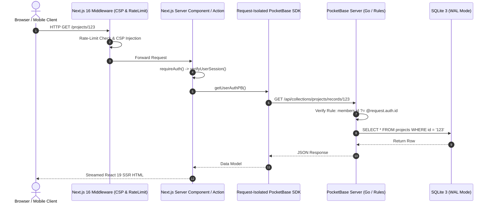

# 🏛️ Technical Architecture & System Hardening Manual
## Vibeforce Flow OS & Klicklaut OS — Enterprise Edition

> **Version:** 2.0.0 (Post-Hardening Architecture)  
> **Zielgruppe:** Senior Software Architects, DevSecOps Engineers, Platform Engineers  
> **Gültigkeit:** Vibeforce Flow OS & Klicklaut OS (White-Label)  
> **Status:** ✅ 100% Gehärtet & Produktionsvalidiert

---

## 1. Systemübersicht & Topologie

Das System kombiniert das Next.js 16 App Router Frontend (React 19 Server & Client Components) mit einer performanten PocketBase (Go/SQLite) BaaS-Instanz im WAL-Modus auf einem dedizierten Hetzner CPX32 Host:

```
                                      [ Internet ]
                                           │
                                     (HTTPS / TLS)
                                           │
                                    [ Traefik Edge ]
                                   (Port 80/443, SSL)
                                           │
                    ┌──────────────────────┴──────────────────────┐
                    │                                             │
         [ Next.js 16 App Router ]                   [ PocketBase BaaS ]
        (Port 3000 / SSR & Edge)                     (Port 8090 / REST & SSE)
                    │                                             │
      ┌─────────────┴─────────────┐                 ┌─────────────┴─────────────┐
      │  - Edge Security Headers  │                 │  - 11 Hardened Collections│
      │  - In-Memory Rate Limiter │                 │  - Atomic Overlap Hooks   │
      │  - SSR Request Isolation  │                 │  - Superuser Auth API     │
      │  - Playwright PDF Pool    │                 │  - Append-Only Audit Logs │
      │  - SSRF-Guard Integrations│                 │  - PRAGMA WAL Concurrency │
      └───────────────────────────┘                 └───────────────────────────┘
                    │                                             │
                    └──────────────────────┬──────────────────────┘
                                           │
                                 [ SQLite 3 Engine ]
                             (data.db, data.db-wal, data.db-shm)
                                           │
                             [ Background Cron Tasks ]
                           (backup_db.js, db_healthcheck.js)
```

---

## 2. Die 12 Kern-Architektur- & Härtungsebenen

### 2.1 PocketBase Multi-Tenancy & IDOR Shield (`backend/harden_rules.js`)
* **Architektur-Ziel:** Vollständige serverseitige Autorisierung aller API-Anfragen. Frontend-Filter dienen ausschließlich dem UI-Rendering.
* **Mechanismus:** 
  - Jede Collection erzwingt `@request.auth.id != ""` und prüft Relationen (`project.members.id ?= @request.auth.id`, `user = @request.auth.id`).
  - Privilege Escalation Prevention in `users.updateRule`: Verhindert, dass normale Benutzer via direkter API-PATCH-Anfrage ihre `role` auf `'admin'` setzen oder `deactivated` manipulieren.
  - Unveränderliche Audit-Logs: `audit_logs.updateRule = null` und `audit_logs.deleteRule = null`.

### 2.2 Playwright Singleton Browser Pool (`frontend/src/lib/pdf-service.ts`)
* **Architektur-Ziel:** Ressourcenschonende, hochperformante PDF-Erstellung (Stundenauswertungen, Kundenberichte) unter Volllast.
* **Mechanismus:**
  - Singleton-Muster mit persistenter Chromium-Instanz (eliminiert ~2.000 ms Prozess-Kaltstartzeit).
  - FIFO-Semaphore (`MAX_PAGES = 3`) garantiert, dass niemals mehr als 3 Render-Jobs gleichzeitig im RAM laufen.
  - AbortSignal-Integration: Schließt Browser-Pages sofort, wenn der Client die Verbindung abbricht oder ein Timeout (15 s) überschritten wird.
  - Memory-Recycling: Automatischer Browser-Neustart nach 50 Jobs oder bei >300 MB Heap.

### 2.3 Next.js 16 SSR Request-Scope Isolation & Token Auto-Retry (`frontend/src/lib/pocketbase-server.ts`)
* **Architektur-Ziel:** Verhinderung von Cross-User Cache Poisoning und Unterstützung von Zero-Downtime Secret Rotation.
* **Mechanismus:**
  - Jede Anfrage instanziiert einen isolierten `new PocketBase()` Client basierend auf den aktuellen Request-Cookies.
  - Superuser-Token wird als unmutierbarer String im Node.js-Speicher für 60 Minuten gecacht (0 ms Overhead).
  - `withAdminPB()` Wrapper: Fängt HTTP 401/403 Fehler ab, flusht den Cache (`invalidateAdminTokenCache()`) und führt einen automatischen Re-Auth mit dem aktuellen Secret durch.
  - `requireAuth()` Guard leitet unauthentifizierte Server-Routen vor dem HTML-Rendering nach `/login` um.

### 2.4 SQLite WAL-Modus & Exponential Backoff Retry Engine (`frontend/src/lib/db-retry.ts`)
* **Architektur-Ziel:** Eliminierung von `SQLITE_BUSY` Fehlern bei Spitzenlasten (z.B. simultane Zeiterfassung am Feierabend).
* **Mechanismus:**
  - PRAGMAs: `journal_mode=WAL;`, `busy_timeout=5000;`, `synchronous=NORMAL;`, `cache_size=-64000;`.
  - `withRetry()` Wrapper führt bei vorübergehenden Lock-Kollisionen bis zu 5 Wiederholungen mit exponentiellem Backoff (100 ms Basis, Faktor 2) und dynamischem ±30% Jitter durch.

### 2.5 Realtime Memory Leak & Echo-Guard (`frontend/src/hooks/useRealtime.ts`)
* **Architektur-Ziel:** Saubere Freigabe von SSE-Verbindungen und Vermeidung von Feedback-Schleifen.
* **Mechanismus:**
  - In-flight Promise Cleanup: Garantiert, dass Subscriptions selbst dann abgeräumt werden, wenn React 19 Komponenten während des asynchronen Verbindungsaufbaus unmounten.
  - `TimestampDeduplicator`: Dropt Events mit `record.updated <= lastSeen` (verhindert veraltete Event-Replays).
  - `RealtimeMutationGuard`: Markiert lokale optimistische Aktionen (`isEcho`), um UI-Flickern und unvollständige Server-Overwrites zu unterbinden.
  - Konfigurierbare Debounce-Warteschlange zur Bündelung von Event-Stürmen.

### 2.6 Next.js 16 Edge Security Headers & CSP (`frontend/src/middleware.ts`)
* **Architektur-Ziel:** Schutz vor Stored/Reflected XSS, Clickjacking, MIME-Sniffing und Downgrade-Angriffen.
* **Mechanismus:**
  - `Content-Security-Policy`: Strikte Whitelist für Scripts, Styles und PocketBase API/WebSocket-Endpunkte.
  - `X-Frame-Options: DENY` & `X-Content-Type-Options: nosniff`.
  - `Strict-Transport-Security: max-age=31536000; includeSubDomains; preload`.
  - `Permissions-Policy: camera=(), microphone=(), geolocation=(), payment=()`.

### 2.7 In-Memory Sliding-Window Rate Limiter (`frontend/src/lib/rate-limiter.ts`)
* **Architektur-Ziel:** Schutz sensibler Endpunkte vor Brute-Force- und Denial-of-Service-Angriffen.
* **Mechanismus:**
  - O(1) Sliding-Window Token-Bucket Limiter im Middleware-Layer.
  - Schützt `/login` (15 Req/Min), `/api/reports/*` (10 Req/Min) und `/api/custom/impersonate` (5 Req/Min).
  - Liefert standardkonforme `HTTP 429 Too Many Requests` mit `Retry-After: <Sekunden>` Header.

### 2.8 Transaktionale Zeiterfassungs-Atomarität (`backend/pb_hooks/time_entries_overlap.pb.js`)
* **Architektur-Ziel:** Ausschluss überlappender Zeiterfassungen für denselben Mitarbeiter.
* **Mechanismus:**
  - Transaktionale Kapselung über `$app.runInTransaction`.
  - Mathematisch exakte halboffene Intervallformel: `start_time < :new_end && end_time > :new_start`.
  - Führt `e.next()` korrekt aus, um Hänger in PocketBase v0.23+ zu vermeiden.

### 2.9 Non-Repudiation Impersonation Audit Trail (`frontend/src/app/api/custom/impersonate/route.ts`)
* **Architektur-Ziel:** Lückenlose Nachvollziehbarkeit administrativer Identitätsübernahmen.
* **Mechanismus:**
  - Zwingender synchroner Audit-Eintrag in `audit_logs` (mit Admin-ID, Zielbenutzer-ID, Zeitstempel) vor Ausgabe des 1-stündigen Tokens.
  - Schlägt das Schreiben des Audit-Logs fehl, bricht die Impersonation sofort mit HTTP 500 ab (Fail-Closed-Prinzip).

### 2.10 Zero-Downtime SQLite Hot Backup Engine (`backend/backup_db.js`)
* **Architektur-Ziel:** Konsistente Datenbanksicherung im laufenden Betrieb ohne Schreibblockaden.
* **Mechanismus:**
  - Verwendet die SQLite Online Backup API (`sqlite3 data.db ".backup backup.db"`).
  - Führt unmittelbar nach dem Backup einen automatischen `PRAGMA integrity_check;` auf dem Snapshot durch.
  - Automatisierte 7-Tage-Rotation alter Backups.

### 2.11 SSRF & DNS-Rebinding Guard (`frontend/src/lib/ssrf-guard.ts`)
* **Architektur-Ziel:** Verhinderung von Server-Side Request Forgery gegen interne Dienste und Cloud-Metadaten.
* **Mechanismus:**
  - Validiert alle ausgehenden Webhook- und E-Mail-URLs vor dem Verbindungsaufbau.
  - Löst DNS auf und sperrt RFC 1918 Private CIDRs (`10.0.0.0/8`, `172.16.0.0/12`, `192.168.0.0/16`, `127.0.0.0/8`), Link-Local (`169.254.0.0/16`) und IPv6-Private Ranges.

### 2.12 Automated SQLite WAL Boot Healthcheck & Recovery (`backend/db_healthcheck.js`)
* **Architektur-Ziel:** Automatische Selbstheilung und Konsistenzprüfung nach Server-Neustarts oder Stromausfällen.
* **Mechanismus:**
  - Führt beim Booten `PRAGMA quick_check;` aus.
  - Prüft die WAL-Größe und flusht bei >50 MB via `PRAGMA wal_checkpoint(TRUNCATE);`.
  - Führt bei B-Tree-Defekten eine automatisierte `.dump`-Recovery durch.

---

## 3. Datenfluss & Request Lifecycle



---

## 4. Operational Runbooks & Deployment

### 4.1 Deployment & Regel-Härtung
Nach jedem Deployment auf dem Produktionsserver (Hetzner CPX32) muss das Härtungsskript ausgeführt werden:
```bash
node backend/harden_rules.js
```

### 4.2 Tägliches Backup & Boot-Healthcheck
In der Crontab (`crontab -e`) auf dem Host:
```bash
# Tägliches Hot-Backup um 03:00 Uhr
0 3 * * * cd /opt/klicklaut/backend && node backup_db.js >> /var/log/klicklaut_backup.log 2>&1

# Boot-Healthcheck bei Server-Neustart
@reboot cd /opt/klicklaut/backend && node db_healthcheck.js >> /var/log/klicklaut_boot.log 2>&1
```

### 4.3 Superuser-Passwort-Rotation
Wenn `POCKETBASE_ADMIN_PASSWORD` in `.env` geändert wird:
1. Neues Passwort in PocketBase Admin UI oder CLI setzen.
2. `.env` aktualisieren.
3. Node.js Service neu starten (oder die `invalidateAdminTokenCache()` Funktion triggert automatisch den Re-Auth).

---

## 5. White-Label Klon-Instanziierung (`vibeforce-flow-os`)
Alle Module sind mandanten- und brand-agnostisch konzipiert. Um eine neue Instanz aufzusetzen, müssen lediglich die Umgebungsvariablen (`POCKETBASE_URL`, `NEXT_PUBLIC_POCKETBASE_URL`) angepasst und `node backend/harden_rules.js` ausgeführt werden.

---

## 6. Modul M007: VIBE Craft Architektur & Datenmodell

### 6.1 Geofencing Engine (`frontend/src/lib/geofencing.ts`)
* **Haversine Algorithmus:** Großkreis-Distanzberechnung in Metern ($R = 6371000\,\text{m}$) mit strikter Koordinaten-Sanitization (`[-90, 90]`, NaN-Schutz).
* **Ray-Casting (Jordan Curve Theorem):** $O(n)$ Schnittpunktzähler für beliebig komplexe, konvexe und konkave Polygone.
* **DwellTimeTracker State Machine:**
  - **Speed Gate:** Geschwindigkeiten $>15\,\text{km/h}$ ($4.16\,\text{m/s}$) setzen den Verweil-Timer zurück (verhindert False-Positives bei Vorbeifahrten).
  - **Hysterese-Zeitfenster:** Mindestverweildauer von $120\,\text{s}$ vor Auslösen des Check-in-Prompts.
  - **Accuracy Filter:** GPS-Punkte mit Ungenauigkeit $>50\,\text{m}$ werden verworfen.

### 6.2 PocketBase Datenmodell & Migrationen (`1781200000_created_craft_collections.js`)
* `projects` (Erweiterung): `geofence_type` (none/circle/polygon), `geofence_data` (JSON: center, radius, polygon), `geofence_auto_prompt` (bool).
* `site_reports`: Bautagesberichte mit Wetter, Temperatur, Freitexten, `qualification_hours` (JSON: meister, geselle, helfer, azubi), `client_signature` & `contractor_signature` (Base64 PNG) sowie Signatur-Zeitstempeln.
* `measurements`: VOB Teil C Aufmaße mit `position_nr`, `title`, `formula`, `quantity`, `unit` (m, m2, m3, h, stk, kg, psch), `unit_price`, `total_price`.
* `evidence_items`: Beweisfotos mit `sha256_hash` (Web Crypto API), `taken_at` (ISO), `gps_lat`, `gps_lon` und Bildanhängen.
* `invoices_zugferd`: E-Rechnungsdatensätze mit ZUGFeRD 2.1.1 BASIC WL XML Payload, `net_total`, `tax_total`, `gross_total`.

### 6.3 ZUGFeRD 2.1.1 BASIC WL & Playwright PDF/A (`frontend/src/lib/craft-pdf-templates.ts`)
* **XML-Spezifikation:** DIN EN 16931 konforme `CrossIndustryInvoice` Struktur (`urn:cen.eu:en16931:2017#compliant#urn:factur-x.eu:1p0:basicwl`).
* **Playwright PDF-Pipeline:** HTML-Template-Rendering über den Singleton `PlaywrightBrowserPool` (`pdfService.renderHtmlToPdf`) mit $2\times$ Device Scale Factor und druckoptimiertem CSS in $\sim 400\,\text{ms}$.

### 6.4 IndexedDB Offline Synchronization (`frontend/src/lib/offline-sync.ts`)
* **Client-Pufferung via `idb`:** Bei Netzausfall (`navigator.onLine === false`) werden Zeiteinträge, Bautagesberichte und Aufmaße in den IndexedDB Store `sync_queue` gepuffert.
* **Auto-Flush Hook (`useOfflineSync`):** Lauscht auf `window.addEventListener('online')` und verarbeitet anstehende Mutationen atomar in FIFO-Reihenfolge mit automatischer Duplikatsvermeidung via UUIDs.

### 6.5 DATEV Buchungsstapel Engine (`frontend/src/lib/datev-export.ts`)
* **Format:** DATEV EXTF Version 700 / ASCII 510 Standard.
* **Kontierung:** Erlöskonto `8400` (SKR03) / `4400` (SKR04) mit 19% USt, Gegenkonto/Debitor `10000`, Kostenstelle = Baustellen-/Projekt-Key.

